  

  
  
  

 

### About

I build and train machine-learning models, ship mobile and desktop apps, and put intelligence into products people actually use.

 

### Now building

- **PLOT** — a mobile-first novel app for Nigerian readers.

 

### What I do

| | |
| :-- | :-- |
| **AI / ML** | Model building, training and integration |
| **Full-stack** | Frontend, backend and databases |
| **Mobile & desktop** | Cross-platform application development |

 

### Stack

  

 

### Activity

<picture>
  <source media="(prefers-color-scheme: dark)" srcset="https://raw.githubusercontent.com/Kennedy200/Kennedy200/output/snake-dark.svg" />
  <source media="(prefers-color-scheme: light)" srcset="https://raw.githubusercontent.com/Kennedy200/Kennedy200/output/snake-light.svg" />
  
</picture>

 

### Open to

Collaborating on impactful open-source projects and AI-driven product builds.
Reach me at **kennedychigozie883@gmail.com**.
